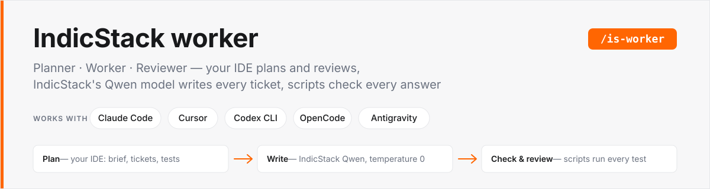
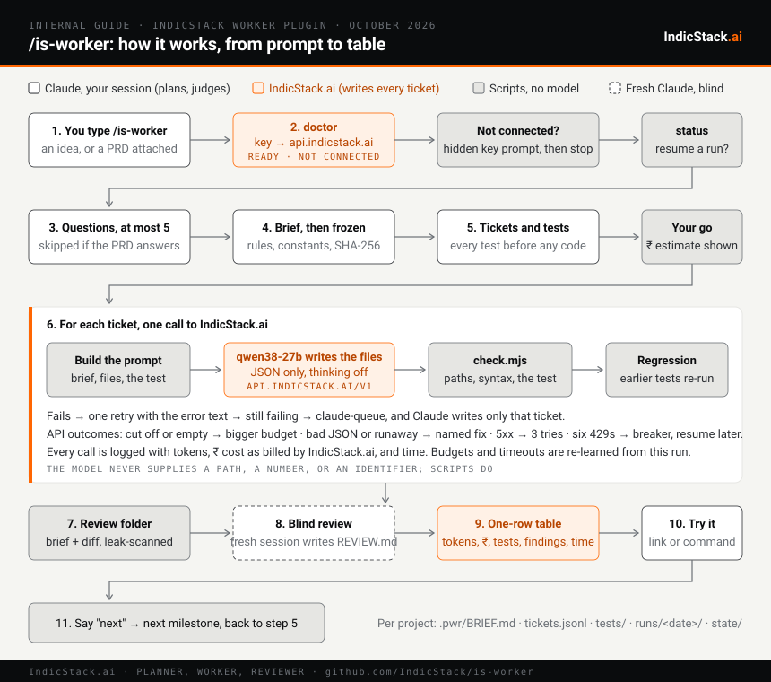

<div align="center">


<h1>IndicStack worker</h1>

<p>Planner-worker-reviewer on IndicStack: your IDE plans and reviews, IndicStack's Qwen model writes every ticket, scripts check every answer.</p>

<p>


</p>

<p>
<a href="#quick-start-claude-code">Quick start</a> ·
<a href="#other-agentic-ides">Other IDEs</a> ·
<a href="docs/USER-GUIDE.md">Guide</a> ·
<a href="docs/data-flow.html">Data flow</a> ·
<a href="https://console.indicstack.ai">Console</a>
</p>

</div>



## What it does

| Planner | Worker | Checker |
|---|---|---|
| Your IDE's model. It asks a few questions, writes a frozen brief, the tickets and their tests, and runs the blind review. | IndicStack's `qwen38-27b` writes every ticket, at temperature 0. | Plain Node scripts run the tests after every ticket. Nothing is accepted on faith. |

Every milestone ends with a one-row table: tokens, ₹ cost, tests, findings, time. Pattern: `explainer.html` (Prasanth Ghanta, Oct 2026).

## Works with

| IDE | Reads | `init --ide` | Reviewer to pick (`--reviewer` or `IS_WORKER_REVIEWER`) |
|---|---|---|---|
| Claude Code | the plugin skill (`/is-worker`) | `claude` (prints the two plugin commands) | `claude` (default; Sonnet, `--model opus` for a deeper look) |
| Cursor | `.cursor/rules/is-worker.mdc` and `AGENTS.md` | `cursor` | `claude` if the claude CLI is installed, else `codex` |
| OpenAI Codex CLI | `AGENTS.md` | `codex` | `codex` |
| OpenCode | `AGENTS.md` | `opencode` | `opencode` |
| Google Antigravity | `AGENTS.md` and `.agent/rules/is-worker.md` | `antigravity` | `claude`, `codex`, or `custom` |

## Quick start (Claude Code)

Copy the text below and paste it into the Claude Code prompt box (the message field at the bottom of the Claude Code window, or the `claude` prompt in your terminal). Claude Code does the rest: it installs the plugin from this repository, checks your IndicStack connection, and starts `/is-worker`.

```
Set up IndicStack for me from https://github.com/indicstack/is-worker, step by step, and wait for me after each step:
1. Run /plugin marketplace add IndicStack/is-worker, then /plugin install is-worker@indicstack.
2. Run the plugin's connection check. If Node is missing, install it. If no IndicStack API key is saved, tell me the exact command to run in my own terminal to save it, and never ask me to paste the key here.
3. When I say "saved", run the check again and confirm it says READY.
4. Then start /is-worker with the idea or PRD I give you next.
```

Or run the two plugin commands yourself inside Claude Code, then type `/is-worker` with your idea:
```
/plugin marketplace add IndicStack/is-worker
/plugin install is-worker@indicstack
```

No IndicStack account yet? Sign up at https://console.indicstack.ai/signup. New accounts receive ₹2,000 of free credit, with no credit card required.

## Other agentic IDEs

Cursor, Codex CLI, OpenCode, Antigravity. The Claude Code plugin is one packaging. The same planner steps live in [AGENTS.md](AGENTS.md), and the harness scripts are plain Node that never depend on which IDE drives them. Three steps:

1. **Clone the harness to a fixed folder** (the project files written in step 2 point at it, so it must stay put), then save your IndicStack key in your own terminal, never in chat.
2. **Run `init` in your project.** It writes the planner instructions where your IDE reads them, with the harness path filled in. An existing `AGENTS.md` is never overwritten: a marked `<!-- is-worker:start -->…<!-- is-worker:end -->` section is appended, or replaced if it is already there. `--ide` is one of `claude|cursor|codex|opencode|antigravity|all`.
3. **Open the project in the IDE and type** `use is-worker to build <your idea>` (or attach a PRD). The agent runs the connection check first, then questions → brief → tickets and tests → run → blind review → table, exactly like `/is-worker`.

| Step | macOS / Linux | Windows |
|---|---|---|
| Clone the harness | `git clone https://github.com/IndicStack/is-worker ~/is-worker` | `git clone https://github.com/IndicStack/is-worker %USERPROFILE%\is-worker` |
| Save the key | `node ~/is-worker/scripts/key.mjs` | `node "%USERPROFILE%\is-worker\scripts\key.mjs"` |
| Init your project | `node ~/is-worker/scripts/is-worker.mjs init --project . --ide cursor` | `node "%USERPROFILE%\is-worker\scripts\is-worker.mjs" init --project . --ide cursor` |
| Check the connection | `node ~/is-worker/scripts/is-worker.mjs doctor --project .` | `node "%USERPROFILE%\is-worker\scripts\is-worker.mjs" doctor --project .` |

The blind review is a second, headless session in an isolated folder. It defaults to `claude` with Opus for the typed call (Sonnet for `--full`; `--model` overrides). `--reviewer codex` runs `codex exec`, `--reviewer opencode` runs `opencode run`, `--reviewer custom` runs any command from `IS_WORKER_REVIEW_CMD`, for example `IS_WORKER_REVIEW_CMD='mytool --cwd "{folder}" "{prompt}"'`, and `--reviewer openrouter` posts the folder to OpenRouter with no CLI at all. Only the claude and openrouter reviewers report tokens and cost; the others show `?` in those columns. `doctor` lists every reviewer CLI it finds and says DEGRADED only when the selected one is missing (runs still work; the review is skipped). The exact CLI flags are in `lib/reviewer.mjs` with the versions they were written against. The IndicStack key is saved the same way in every IDE: `node ~/is-worker/scripts/key.mjs` in your own terminal, never in chat.

## What's new in 0.10.1

The size rule is opt-in. Builds plan qwen targets from the requested features only; `--target-kb` and the size planning apply only when the user explicitly asks for a code size. Before, aiming for a size could add files and qwen calls (Ledgerly: 66 qwen calls and 11 min against 21 calls and 5 min) without adding features.

## What's new in 0.10.0 — a built-in token economizer

is-worker now includes [TokenEconomizer](https://github.com/microsoft/TokenEconomizer) (Microsoft Research / UC Berkeley, Apache-2.0; see `economizer/NOTICE`). Still one plugin and one `/is-worker`: no extra commands to learn. It learns from a repository's past sessions, with no model calls: facts sessions keep rediscovering (stated at the next session start), tools that go unused (left out), and edit-test loops that keep failing (one redirect).

**It stays off until a repository has history.** Every hook answers "no change" until 5 sessions of that repository have been folded. History does not need the economizer to have been on: it is Claude Code's own transcripts, which exist either way; at each session start the gate folds any not yet folded, in the background, so a repository reaches the threshold by being used. Set `IW_TE_MIN_SESSIONS` to change the threshold. **Needs Python 3.10+** (doctor's `python:` line says whether it is on); without it builds work exactly as in 0.9.0. `is-worker economizer` shows what it has learned (`status`, `facts`, `toolprune show`, `untool`, `config`).

Measured so far: one cold Ledgerly build with the hooks on (before the gate) added 0 tokens of overhead and learned nothing from one session, as expected. Its savings on repeated sessions in one repository (the paper reports 18–31% on SWE-Bench) are not yet measured on our builds.

## What's new in 0.9.0 — the sibling route, automatic

is-worker now decides by itself. The skill triggers on any app-sized request (about 15 KB or more of new code) without `/is-worker`, and picks a route: **direct** for small edits, **siblings** (the default for apps) or **tickets** for large builds without repetition.

The sibling route: Claude writes the novel core and one example per family of similar files (views, charts, small pure modules, data, CSS); IndicStack's qwen writes the rest from `.is-worker/expand.json`; one command finishes the build:

```
node scripts/is-worker.mjs build --project <dir> --target-kb 100 --commit "message" [--baseline <app>]
```

It self-tests every pattern on its example (a broken test costs no worker calls), runs expand with three parallel retries for failed targets, checks and imports every module, warns when the app is under 80% of the asked size, commits and prints the token table. Built-in test kinds (`pure-fn`, `html-view`, `svg-chart`) mean Claude writes test data, not test code; `"digest": true` gives qwen the interface from code and a live fixture instead of prose. `expand --reference` prints the whole format. `digest` / `digest --query` let the planner read qwen-written summaries instead of long files. The table now reads the chat's tool calls (an Adoption line: code Claude wrote itself, specs, files opened, harness runs), pools repeated frontier-alone baselines, prices each column at its own model and flags a model mismatch.

Measured on Ledgerly (same spec, Opus 5.5, 22 Oct 2026; one run each):

| Build | Opus calls | App | From qwen | Opus cost | Opus $/KB |
|---|---|---|---|---|---|
| Opus alone | 10 | 109.2 KB | — | $1.844 | $0.0169 |
| 0.8.6-era expand (v2) | 11 | 73.6 KB | 36% | $1.535 | $0.0209 |
| L1–L4, no turn budget (v3) | 22 | 103.8 KB | 59% | $1.788 | $0.0172 |
| **0.9.0 four-turn route (v4)** | **5** | 53.4 KB | 51% | **$0.854** | **$0.0160** |

v4 is the first build below Opus alone per KB, at half the Opus calls; it also came out at half the asked size, which the new sizing rule and `--target-kb` warning address. An earlier "Opus alone" Ledgerly baseline was in fact built by claude-fable-5-1; it is relabelled in `alone-baselines.json`.

## What's new in 0.8.6 — an honest token table

0.8.5's table counted every chat that mentioned the project folder as "planning" (Flappy Bird: 678 calls, 125 million tokens, nine days). 0.8.6 counts only the session that runs `table`, from its `/is-worker` command, and shows `?` from any other chat. It adds a cost-at-list-price row, because a cache-read token is 5% of a new-input token and a token total that is mostly re-reads is not a cost. "Saved vs alone" is shown in cost and only against a measured alone build. The `claude` reviewer falls back to `openrouter` when the CLI is blocked for the account.

## What's new in 0.8.3 — review without the gate

The typed review no longer asks the worker model first. One frontier call answers the planner's cross-file statements (and the per-ticket statements of troubled tickets); clean tickets' own statements are skipped because their tests pinned them and, across every measured run, they never produced a finding. Saves ~36 s and ₹3 per review on Flappy Bird. `--gate` restores the worker-model pass.

## What's new in 0.8.2 — parallel lanes

Tickets whose dependencies are done now run side by side: the API arms default to concurrency 4 (`arms.default.json`), because IndicStack batches concurrent requests (4 ticket-sized calls finished in 7.5 s against 5.5 s for one), and the AIMD limiter halves the lane count on any 429/503. A ticket that rewrites an earlier ticket's file gets that ticket's test in its prompt (keep-green). Flappy Bird, live run 21 Oct 2026: write phase 58 s (was 89 s), whole run with typed review ₹11.36 and 2 min 2 s (12 Oct: ₹51 and 3 min 52 s).

## What's new in 0.8.1 — direct mode

`/is-worker` now starts the way a direct build does: no questionnaire, no "ok to freeze?", no pasted ticket list, no waiting for "go" on small builds. The planner states its assumptions in one line, freezes the brief, writes tickets, tests and checklist, and runs when the estimated worker cost is at or under `auto_go_inr` (defaults.json, ₹50). It asks one question only when a wrong guess would change the architecture; say "ask me first" to get the old five questions. A PRD still drives milestones when it names phases; otherwise one milestone.

## What's new in 0.8.0 — typed review

The blind review no longer reads the whole project and writes prose. The planner writes a checklist with the tickets (`.is-worker/checklist.json`: statements that are true when the code is fine, including cross-file ones, and one bug-risk score per ticket). `review` then runs in two halves: IndicStack's worker model judges every statement with one token and its logprobs (about ₹0.10 and 1 s each); the ones it is not sure about go to the frontier reviewer in ONE call over the files involved, answered as JSON. Every NO is a finding with file, line and reason. Flappy Bird, 21 Oct 2026, same code and tests: prose review ₹24.37 and 98 s with 5 findings; typed review ₹8.88 and 57 s with the same 5 findings (`experiments/typed-review/RESULTS.md`).

- `review` is typed by default; `--full` is the old prose review (Sonnet, skipped on clean runs).
- New reviewer `--reviewer openrouter`: no CLI needed; the blind folder goes to OpenRouter (`OPENROUTER_API_KEY` or `IS_WORKER_KEY_C`), exact cost comes back. Use it where `claude -p` is not allowed.
- Gate settings live in `defaults.json` (`review_gate_threshold` 0.85, `review_gate_risk_open` 2.5, `review_models`), with the reason for each value.
- `table` adds a note line: statements closed by the worker model, statements answered by the reviewer, and the cost of each.

## What's new in 0.7.2

- The review skips itself when every ticket passed first try and all tests are green; `--force` runs it anyway.
- Otherwise it reviews only the files of tickets that were retried or failed; `--full` reviews everything.
- The default reviewer model is Sonnet; `--model opus` for a deeper look.
- Size gate: a build likely under ~15 KB of code is offered as a direct build instead; tickets get 2–3 tests each.

## Install (Mac, Windows, Linux)

Needs Claude Code 2.1.289+. Node 18+ is needed too; if it is missing, `/is-worker` installs it for you (winget on Windows, Homebrew on Mac) or gives you the download link. No Python.

Inside Claude Code:
```
/plugin marketplace add IndicStack/is-worker
/plugin install is-worker@indicstack
```
Then type `/is-worker` with your idea. The first thing it does is a connection check (`doctor`): Node, the reviewer CLI (`claude` by default), and whether IndicStack accepts your key. If no key is saved it opens the key prompt for you (hidden input, never in chat) and refuses to plan or write code until IndicStack answers `READY`. Alternatively set the `INDICSTACK_API_KEY` environment variable before starting Claude Code.

Check the connection yourself any time:
```
node "<plugin folder>/scripts/is-worker.mjs" doctor
```

## Cost

New IndicStack accounts get ₹2,000 of free credit on sign-up, with no credit card or payment details needed. The worker model `qwen38-27b` is priced at ₹21 per 1M input tokens and ₹190 per 1M output tokens (October 2026); a 15-ticket milestone has cost about ₹9 of that in practice.

## Guide

Step-by-step with screenshots, from sign-up to the first table: [docs/USER-GUIDE.md](docs/USER-GUIDE.md).

## Workflow



Shown for Claude Code; Cursor, Codex, OpenCode and Antigravity follow the same flow, with the reviewer of your choice at the blind-review step.

## Use

Open any project folder in Claude Code and type `/is-worker` followed by your idea, or attach a PRD. The skill asks a few questions, writes a frozen brief, tickets and tests, waits for your go, runs IndicStack on every ticket, runs a blind review, and prints a one-row table (tokens, ₹ cost, tests, findings, time).

Per-project files live in `<project>/.is-worker/` (brief, tickets, tests, runs, state). Run logs are git-ignored.

## Layout

- `skills/is-worker/SKILL.md` — the recipe Claude follows (the /is-worker command)
- `AGENTS.md` — the same recipe for any coding agent (Cursor, Codex, OpenCode, Antigravity); `init` copies it into a project
- `scripts/is-worker.mjs` — init, doctor, status, preflight, run, review, table
- `scripts/key.mjs` — saves the IndicStack key (hidden input)
- `lib/init.mjs`, `lib/reviewer.mjs` — the per-IDE instruction files and the pluggable blind reviewer (claude, codex, opencode, custom)
- `docs/workflow.svg` — the end-to-end flow from prompt to table
- `docs/data-flow.html` — what goes where, element by element
- `worker.mjs`, `check.mjs`, `probe.mjs`, `calibrate.mjs`, `lib/` — the harness
- `review/` — isolated blind review folder builder and its byte-identical prompt
- `BRIEF.md`, `tickets.jsonl`, `tests/` — the Flappy Bird bench task

## Upgrading from an older name

If you installed `pwris@indicstack` or `is@indicstack` before 12 Oct 2026:
```
/plugin uninstall is@indicstack
/plugin marketplace remove indicstack
/plugin marketplace add IndicStack/is-worker
/plugin install is-worker@indicstack
```

---

<p align="center">Built by IndicStack · <a href="https://console.indicstack.ai">console.indicstack.ai</a> · inference runs in India, nothing is trained on your data.</p>
