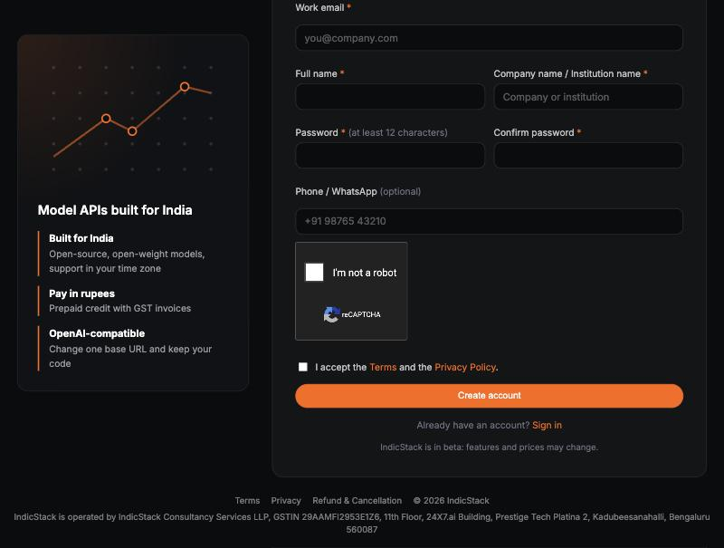
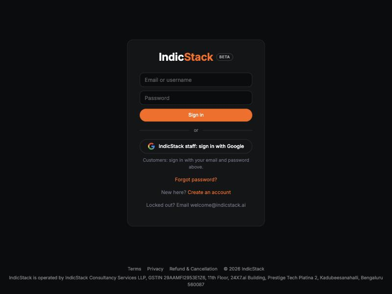
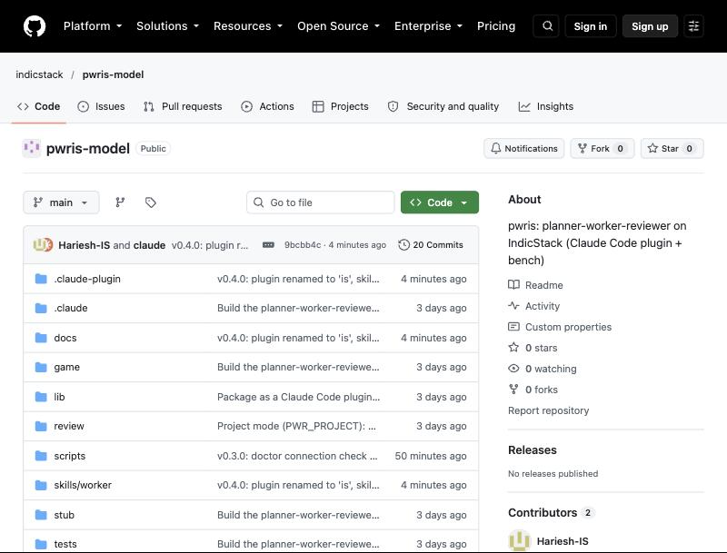

# Using IndicStack with `/is-worker` — the complete guide

`/is-worker` is a Claude Code plugin. You describe an app or attach a PRD; Claude plans and reviews, IndicStack's Qwen model writes every piece of code, and scripts check every answer. At the end of each milestone you get a one-row table of tokens, rupees, tests and time, plus a way to try what was built.

Works on Mac and Windows, in the Claude Code CLI and the Claude desktop app. The same steps run in Cursor, OpenAI Codex CLI, OpenCode and Google Antigravity; see section 4a.

---

## 1. Create your IndicStack account

Open **https://console.indicstack.ai/signup**.



1. Fill in work email, full name, company or institution, and a password of at least 12 characters.
2. Tick "I'm not a robot" and accept the Terms.
3. Press **Create account**. IndicStack emails you a confirmation link; the account opens once you click it.

Then sign in at **https://console.indicstack.ai/login** with that email and password.



## 2. Add credit and create an API key

In the console:

1. Every new account starts with **₹2,000 of free credit**, with no credit card or payment details needed, so you can run your first milestones without paying anything. After that, add prepaid credit in rupees with a GST invoice.
2. Pricing for the worker model, as of October 2026:

   | Model | Input price | Output price |
   |---|---|---|
   | qwen38-27b | ₹21 per 1M tokens | ₹190 per 1M tokens |

   A first milestone of 10 to 15 tickets costs about ₹10 on the worker side, so the free credit covers roughly 200 such milestones.
3. Open **API keys** and create a key. Copy it once and keep it somewhere safe such as a password manager. You will paste it into a hidden terminal prompt in step 5, never into a chat.

> Owner note: add a screenshot of the API keys page here as `img/03-api-key.jpg` once logged in.

## 3. Install Claude Code

Follow https://code.claude.com/docs/en/overview for the CLI, or install the Claude desktop app and open its Code tab. Sign in with your Claude account. Node.js is needed too, but `/is-worker` installs it for you in step 5 if it is missing.

## 4. Install the plugin

Inside Claude Code, run these two commands one after the other:

```
/plugin marketplace add IndicStack/is-worker
```
```
/plugin install is-worker@indicstack
```



If you installed an older name (`pwris@indicstack` or `is@indicstack`) before 12 October 2026, uninstall it first and re-add the marketplace: `/plugin uninstall is@indicstack`, `/plugin marketplace remove indicstack`, then the two commands above.

## 4a. Using Cursor, Codex, OpenCode or Antigravity instead

You do not need Claude Code. The planner steps are also in the harness's `AGENTS.md`, and the scripts are plain Node.

1. Clone the harness to a fixed folder: `git clone https://github.com/IndicStack/is-worker ~/is-worker`
2. In your project: `node ~/is-worker/scripts/is-worker.mjs init --project . --ide cursor` (or `codex`, `opencode`, `antigravity`, `all`). It writes `AGENTS.md` (Cursor, Codex, OpenCode, Antigravity), `.cursor/rules/is-worker.mdc` (Cursor) and `.agent/rules/is-worker.md` (Antigravity) as needed, keeping anything already in those files.
3. Open the project in the IDE and type `use is-worker to build <your idea>`.

The blind review (step 6 below) uses the `claude` CLI by default. If you do not have it, pick the reviewer your IDE ships with: `--reviewer codex` (Codex CLI), `--reviewer opencode` (OpenCode), or `--reviewer custom` with `IS_WORKER_REVIEW_CMD` set to any command that takes `{folder}` and `{prompt}`. Only the claude reviewer reports tokens and cost. Everything else, including how the key is saved, is identical.

## 5. First run: connect

Open the folder of your project (new or existing) in Claude Code and type:

```
/is-worker
```

The first thing it does is a connection check. You will see one of these lines:

| Line | Meaning | What happens next |
|---|---|---|
| `IS-WORKER: READY` | Node, the selected reviewer CLI (`claude` by default) and your IndicStack key all work | It continues |
| `IS-WORKER: NOT CONNECTED — no IndicStack key` | No key saved yet | It opens a hidden key prompt for you (see below) |
| `IS-WORKER: NOT CONNECTED — IndicStack rejected the key` | Wrong or expired key | Same prompt; paste the correct key |
| `IS-WORKER: NOT CONNECTED — unreachable` | Network or IndicStack is down | Check your network, or email welcome@indicstack.ai |
| `IS-WORKER: DEGRADED` | The selected reviewer CLI (`claude` by default) is not on the PATH | Runs work; the blind review is skipped until fixed, or pick another with `--reviewer` |

If Node is missing, it installs it (winget on Windows, Homebrew on Mac) and asks you to restart Claude Code once.

**The key prompt.** In the desktop app, Claude opens the Terminal panel and runs the key command there. In the CLI, it prints the command for you to run in a second terminal window:

```
node "<plugin folder>/scripts/key.mjs"
```

Paste your IndicStack key when asked. Typing is hidden. The key is saved to `~/.is-worker/keys.env` with owner-only permissions, and never appears in chat or logs. Say **saved**, and the check runs again.

Claude will not plan or write code until this says READY. That is deliberate: it stops the silent failure where Claude quietly does all the work itself.

## 6. Describe your app

Type `/is-worker` followed by your idea, as messy as you like, or attach a PRD:

```
/is-worker @MyApp_PRD.docx
```

What follows, in order:

1. **Questions** (at most five), only the ones a PRD doesn't already answer.
2. **Brief**: a plain-words spec with numbered rules. You say "ok to freeze"; it is then hashed and cannot change silently.
3. **Milestones and tickets**: one PR per milestone, 4 to 15 small tickets each, every ticket with its test written before any code.
4. **Your go**: the ticket list and a rupee estimate. Say "go".
5. **The run**: IndicStack writes each ticket; scripts check paths, syntax, the ticket's test and all earlier tests. A failed ticket is retried once with the error, then handed to the planner (Claude in Claude Code) for that one ticket only.
6. **Blind review**: a fresh session of the reviewer CLI (claude by default; codex, opencode or a custom command), in an isolated folder, judges the code without knowing who wrote it.
7. **The table** and a link or command to try the result.

Say **next** for the next milestone, or **status** at any time for a one-line summary.

## 7. Reading the table

| Column | Meaning |
|---|---|
| Worker tokens in/out, worker cost | What IndicStack used and billed, in rupees |
| Review tokens, review cost | The blind review session (the header names the reviewer), converted to rupees at the day's rate; codex, opencode and custom reviewers report no tokens, shown as ? |
| First try | Tickets that passed without a retry |
| Final tests | All tests across all tickets, after the last ticket |
| Findings | Logic findings the blind reviewer raised |
| Total cost, total time | Worker plus review |

From real runs in October 2026: a 15-ticket milestone cost about ₹9 on IndicStack and about ₹75 for the Opus review. The review is the expensive part; the typing is nearly free. Since v0.7.2 the review skips itself on a clean run (every ticket first try, all tests green), reviews only the troubled tickets otherwise, and uses Sonnet by default, so that ₹75 is now the exception rather than the rule.

## 8. Where things live

```
your-project/
  .is-worker/
    BRIEF.md          the frozen spec
    tickets.jsonl     the tickets
    tests/            one test per ticket
    runs/<date>/      every call, every output, never overwritten
    state/            probe, self-calibration
  src/ ...            the code IndicStack wrote, in your tree
```
`.is-worker/runs/` and `.is-worker/state/` are added to `.gitignore` automatically.

## 9. Troubleshooting

- **The command shows as `/is-worker:is-worker` or `/is-worker-is-worker`.** That is the plugin's full name (plugin:skill). The short form `/is-worker` works too.
- **NOT CONNECTED after saving the key.** Run the check yourself: `node "<plugin folder>/scripts/is-worker.mjs" doctor`. A `length` far from your key's real length means a paste error.
- **IndicStack is slow or times out.** The harness waits up to 60 s for the first token and retries once. If it keeps happening, email welcome@indicstack.ai; GPUs are sometimes taken offline for maintenance.
- **A ticket went to the queue.** The planner (Claude in Claude Code) writes that one ticket and submits it through the same checker. Everything else stays with IndicStack.
- **Python or pip errors.** Nothing here uses Python. If you see such errors they come from your project, not the plugin.

## 10. Keeping it updated

Check which version you have: in Claude Code run `/plugin list` (it shows `is-worker@indicstack <version>`), or ask Claude Code to run the plugin's doctor — the first line is `is-worker: <version>`.

Update:

```
/plugin update is-worker@indicstack
```
